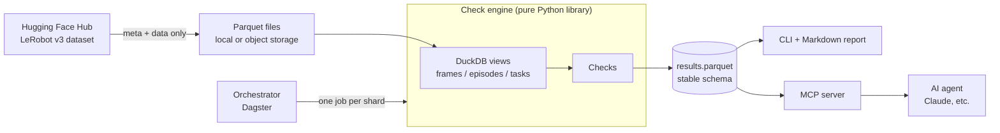

# robot-data-check

> Data quality checks for robot learning datasets in the LeRobot format. Runs as a CLI, scales out as a data pipeline, and exposes results to AI agents through an MCP server.

  

<!-- TODO: replace with a short GIF: asking Claude "which episodes have dropped frames?" and getting a correct answer -->


## Why

Robot learning datasets are recorded by many people, on many machines, across many sites. Small problems slip in silently: dropped frames, broken timestamps, stale normalization stats, idle segments, frozen cameras. Each one quietly degrades policy training, and most datasets are published without any systematic quality check.

**robot-data-check** scans any LeRobot v3 dataset, flags problems per episode and writes every finding to a single, stable results table. Three layers sit on top of one check engine:

- **CLI** — check a dataset locally and get a Markdown report.
- **Pipeline** — run the same checks as stateless shard jobs, orchestrated with incremental processing, writing to object storage.
- **Agent interface** — an MCP server that lets Claude (or any MCP client) query, diagnose and explain dataset quality in natural language, with a measured evaluation of how well it does.

## What it checks

| Check | What it detects | Method | Severity |
|---|---|---|---|
| `episode_bounds` | Metadata length ≠ actual frame count | SQL join episodes ↔ frames | error |
| `timestamps` | Dropped frames, non-monotonic or off-fps timestamps | Window functions vs `1/fps` | error / warning |
| `frame_index` | Gaps or duplicates in frame indices | Min / max / count per episode | error |
| `stats` | `stats.json` inconsistent with the actual data | Recompute mean / std / min / max | warning |
| `action_jumps` | Sudden spikes between consecutive actions | Thresholds from the dataset's own distribution | warning |
| `idle_segments` | Robot not moving for long stretches | Rolling-window state change | warning |

Each episode also gets a quality score aggregated from its issues. <!-- TODO: document the scoring formula once fixed -->

Planned: frozen / black camera frames, instruction ↔ video consistency. See [Roadmap](#roadmap).

## Quickstart

```bash
uv sync

# Check the first 200 episodes (0..199) of a Hub dataset
# (downloads metadata and data only, no videos)
uv run robocheck check lerobot/droid_1.0.1 --episodes 0-200 --out report/

# Run the tests (synthetic data, no network)
uv run pytest
```

Output:

- `report/summary.md` — human-readable report
- `report/results.parquet` — one row per detected issue, queryable with SQL

```bash
# Example: query results directly with DuckDB
duckdb -c "SELECT check_name, count(*) FROM 'report/results.parquet' GROUP BY 1 ORDER BY 2 DESC"
```

## Results on DROID

<!-- TODO: fill in with real numbers only after running. Never publish placeholder numbers. -->

| Metric | Value |
|---|---|
| Episodes scanned | TODO |
| Episodes with ≥1 error | TODO |
| Most common issue | TODO |
| Scan time / cost | TODO |

**Key finding:** TODO (e.g. how quality metrics differ between successful and failed episodes, or across collection sites).

## Architecture



The check engine knows nothing about the CLI, the orchestrator, MCP or any agent. Every interface is a thin adapter over the same engine, so any of them can change without touching the checks.

### Results schema (the stable contract)

Every check writes rows with the same schema. Downstream consumers (reports, agents, pipelines, dashboards) depend only on this table.

| Column | Type | Meaning |
|---|---|---|
| `dataset` | string | Hub repo id |
| `dataset_revision` | string | Dataset commit / version scanned |
| `shard` | string | Shard the row was produced by |
| `episode_index` | int | Episode the issue belongs to |
| `check_name` | string | Which check produced the row |
| `check_version` | string | Version of the check logic |
| `severity` | string | `error` or `warning` |
| `value` | double | Measured value (e.g. number of dropped frames) |
| `detail` | string | Human-readable explanation |

## Agent interface (MCP)

| Tool | Description |
|---|---|
| `run_checks(dataset)` | Run all checks, return a summary |
| `query_sql(sql)` | Read-only SQL over dataset views and results |
| `episode_summary(dataset, episode_index)` | All issues for one episode |

Tools return summaries first and paginated detail on request (row limits + offset), so the agent pulls only what it needs instead of flooding its context window.

Example questions an agent can answer:

- "Which episodes have dropped frames?"
- "List the 10 lowest-quality episodes and explain why."
- "Do failed episodes differ from successful ones on any quality metric?"

### Safety

- `query_sql` runs on a **read-only DuckDB connection** with external access disabled and configuration locked. A query cannot write data, read arbitrary local files or reach the network. Credentials (Hugging Face token, cloud keys) are never reachable from that connection.
- Text that comes from datasets (task descriptions, language annotations) is written by third parties and may contain prompt-injection attempts. It is returned **explicitly marked as data**, never as instructions.

### Setup

<!-- TODO: verify once the MCP server is implemented -->

Claude Code:

```bash
claude mcp add robot-data-check -- robocheck mcp
```

Claude Desktop (`claude_desktop_config.json`):

```json
{
  "mcpServers": {
    "robot-data-check": {
      "command": "robocheck",
      "args": ["mcp"]
    }
  }
}
```

### Agent evaluation

A tool interface is only useful if agents answer correctly with it. The agent eval set contains questions with ground-truth answers computed directly in SQL, covering lookups ("how many episodes have dropped frames?"), rankings ("which 5 episodes have the most action spikes?") and analysis ("do failed episodes have more idle time?").

For each question, the agent's answer is compared against the ground truth, and tool calls and tokens used are recorded.

<!-- TODO: fill in after running -->

| Tool design | Accuracy | Avg. tool calls | Avg. tokens |
|---|---|---|---|
| 3 general tools (current) | TODO | TODO | TODO |
| Many narrow tools (baseline) | TODO | TODO | TODO |

Findings: TODO (e.g. where the agent fails, and what interface change fixed it).

## Pipeline at scale

For datasets too large to check on one machine, the same engine runs as a pipeline:

- **Sharding** — the dataset is split into shards of episodes; each shard is one stateless job.
- **Idempotency** — each job writes results keyed by dataset, revision, shard and check version. A failed job is simply re-run and overwrites its own output; nothing needs to be rescued.
- **Incremental processing** — only shards whose data or check version changed are recomputed.
- **Orchestration** — shards are modelled as partitions in Dagster, so backfills, retries and partial re-runs come for free.
- **Storage** — data is queried in place on object storage with DuckDB; results land as Parquet next to it.

<!-- TODO: fill in after running -->

| Metric | Value |
|---|---|
| Episodes processed | TODO |
| Shards / parallel workers | TODO |
| Wall-clock time | TODO |
| Cost | TODO |
| Re-run time after a check version bump on one check | TODO |

## Check evaluation

Each check is tested by injecting known faults into a clean synthetic dataset and measuring detection and false-positive rates.

<!-- TODO: fill in after running -->

| Injected fault | Target check | Detection rate | False positives |
|---|---|---|---|
| Deleted frames | `timestamps`, `episode_bounds` | TODO | TODO |
| Shuffled timestamps | `timestamps` | TODO | TODO |
| Duplicated frame indices | `frame_index` | TODO | TODO |
| Corrupted stats | `stats` | TODO | TODO |
| Action spikes | `action_jumps` | TODO | TODO |
| Inserted idle segments | `idle_segments` | TODO | TODO |

## Design decisions

- **Query Parquet in place with DuckDB** — no ingestion step; the same SQL works locally and on object storage.
- **Metadata-first downloads** — videos are most of the dataset size and are skipped unless a visual check needs them.
- **Thresholds from the data itself** — anomaly thresholds come from each dataset's own distribution, not hard-coded constants.
- **Engine separated from interfaces** — checks live in a library with no dependency on the CLI, orchestrator, MCP or any agent framework. The results schema is the contract; everything else is replaceable.
- **Deterministic checks, agent for exploration** — quality checks are SQL and code: reproducible and unit-tested. The agent interprets and explores results; it never decides on its own whether data is broken.
- **Few general tools instead of many narrow ones** — the agent gets a small set of general tools rather than pre-baked answers, so the interface does not encode today's model limitations. This choice is measured in the agent evaluation, not just assumed.
- **Agent access restricted at the engine level, not by filtering SQL** — string-filtering SQL is fragile; a locked-down connection is not.
- **Why not a generic data quality framework?** — tools like Great Expectations validate tables row by row and column by column. Robot data needs per-episode, time-series checks (dropped frames, action continuity, idle stretches) and dataset-specific metadata checks, which are simpler to express directly in SQL over the LeRobot layout.

## Project structure

<!-- TODO: keep in sync with the code -->

```
robot-data-check/
├── src/robot_data_check/
│   ├── engine/        # loading, DuckDB views, checks, results schema
│   ├── cli/           # robocheck CLI + Markdown report
│   ├── mcp/           # MCP server (thin adapter)
│   └── pipeline/      # Dagster assets, shard jobs, storage
├── tests/
│   ├── fault_injection/
│   └── agent_eval/
└── docs/
```

## Roadmap

**Phase 1 — Core engine**
- [x] Load dataset, DuckDB views, schema inspection
- [ ] Bounds, timestamp and frame-index checks + fault-injection tests
- [ ] Stats and action anomaly checks, unified results and quality score
- [ ] CLI + Markdown report
- [ ] Results on a DROID subset + write-up

**Phase 2 — Agent interface**
- [ ] MCP server (read-only sandboxed connection, paginated results)
- [ ] Agent eval set with ground-truth answers
- [ ] Tool design comparison + demo GIF

**Phase 3 — Pipeline at scale**
- [ ] Stateless, idempotent shard jobs writing to object storage
- [ ] Dagster orchestration with incremental processing
- [ ] Full-scale run with time and cost numbers

**Later**
- [ ] Visual checks (frozen / black frames)
- [ ] Instruction ↔ video consistency

## Limitations

- Only LeRobot v3 datasets are supported.
- Anomaly thresholds are derived per dataset but have so far been validated on a small number of datasets.
- Visual checks are not yet implemented; problems that only show up in video (frozen or black frames) are not detected.
- A flagged issue is not always a real problem: some "idle segments" or "action jumps" may be intentional behaviour. Results are signals for review, not automatic verdicts.

## Acknowledgements

- [LeRobot](https://github.com/huggingface/lerobot) by Hugging Face
- [DROID](https://droid-dataset.github.io/) dataset — please cite the DROID paper if you use results on it

## License

Apache-2.0
